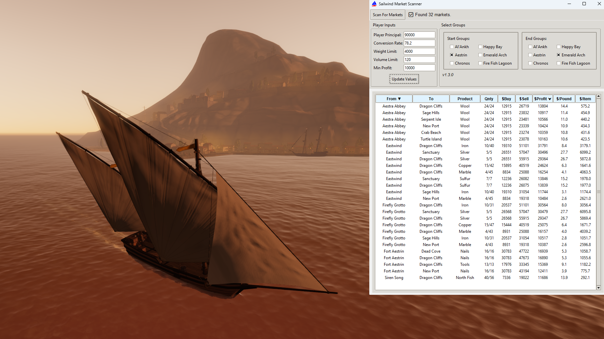

# ⛵ Sailwind Market Watcher for 0.33.2


A real-time market and trade route analyzer for the open-world sailing game **Sailwind**.

This tool connects to your running game, reads market data directly from memory, and helps you plan the most profitable trade routes between ports — all via an interactive graphical interface.

---

🚀 **How to Use**

1. Launch Sailwind
2. Once in-game, double-click **Launch Market Watcher.bat**
3. Click "Scan For Markets" in the GUI
4. Enter your player values:
   - Currency exchange rate
   - Cargo limits (mass/volume)
   - Available money
   - Minimum profit
5. Select your start and destination island groups
6. Browse the trade table for top opportunities!

### Read the Port Market

After scanning, choose a **Departure port** such as **Gold Rock City**, then
open **Port Market**. Hover over a column heading for a quick explanation.

| Column | What it shows |
| --- | --- |
| **Product** | The commodity at the selected port. |
| **Stock** | The estimated number of crates available to buy. A zero means none are available. |
| **Est. Buy / Crate** | What you would pay for the next crate. A dash means the good is out of stock. |
| **Est. Sell / Crate** | What the port would pay for one crate you already own. A port can have a sell quote even when its stock is zero. |

For example, **Stock 21**, **Buy 247**, and **Sell 242** means the port has an
estimated 21 crates for sale, the next one would cost about 247, and the port
would pay about 242 for one crate you sell. Prices can change as you buy or
sell, so multiplying a one-crate price by the quantity gives a rough estimate.

### Read Trade Routes

Use **Port Market** to check what is available locally. Switch to **Trade
Routes** to see where you could sell it and what you might earn on the planned
load. In **Qnty**, a value like **5/21** means the route uses 5 of the estimated
21 crates available at the departure port. **$Buy**, **$Sell**, and **$Profit**
are totals for those 5 crates. The budget, cargo limits, and minimum profit
filter apply to this tab.

Choose a specific **Departure port** to plan trades from that port. Choose
**Selected start groups** to browse departures by region. **End Groups**
controls which destinations the route table considers. Click **Update Values**
to apply and save your player inputs.

---

## 📌 Features

✅ **Live Memory Scan**\
Scans all 32 in-game markets for live product supply data and prices.

💰 **Profit-Driven Trade Routes**\
Automatically finds the most profitable trades based on:

- Total profit
- Profit per pound (weight)
- Profit per item

🎯 **Player-Conscious Filtering**\
Takes into account your current:

- Money
- Cargo mass & volume limits
- Minimum profit threshold

🌎 **Regional Trade Planning**\
Select specific **start** and **destination** island groups to tailor your strategy.

🖼️ **Interactive GUI**\
A modern, user-friendly interface with:

- Sortable Columns for simple analytics
- Live-updating trade table
- Tooltips for helpful guidance
- Input fields for cargo & currency

---

💡 **Development** This project is written in Python using:

- `tkinter` for the GUI
- `pymem` for memory access
- `Pillow` for image icons

Run the offline tests and code checks from the repository folder:

```powershell
python -m pip install -r requirements.txt ruff
python -m unittest discover -s tests -v
python -m ruff check .
python -m ruff format --check .
```

For a live Sailwind 0.41 check, load your save at Gold Rock City and scan from
PowerShell. Compare Goods stock and a one-crate purchase quote with the current
in-game market. The offline pricing tests use synthetic supply values. The
console reports separate timings for region queries, memory reads, signature
matching, and market loading.

See [CHANGELOG.md](CHANGELOG.md) for changes in progress and release history.

---

🧠 **How It Works**

- Uses `pymem` to attach to the running `Sailwind.exe` process
- Scans for a known byte pattern to locate in-game market objects
- Reads each market’s name, product list, and supply value directly from memory
- Applies the game’s pricing formula to calculate sell/buy values dynamically:

```python
def calc_sell_price(supply, V):
    coeff = 0.38 if supply > 0.5 else -1.68
    return ceil((coeff * V / 10000) * (supply**2) - (abs(coeff) * V / 50) * supply + V)
```

- Builds a table of trade routes, ranked by total and per-item profit

---

💱 **Currency Conversion** The game uses different currencies in different regions (Lions, Dragons, Crowns, etc). To calculate trades properly:

1. Visit a Currency Exchange port in the game
2. Use the posted exchange rate to convert to Lions
3. Enter that value into the app’s Conversion Rate field

💡 Estimated values shown in the app:

```
Lions ≈ 34.0
Dragons ≈ 330
Crowns ≈ 82.0
```

Use the actual in-game rate when possible for best results.

---

## 🧰 Requirements

- Windows OS
- Python 3.9+
- The game [**Sailwind**](https://store.steampowered.com/app/1284190/Sailwind)[ on Steam](https://store.steampowered.com/app/1284190/Sailwind) Version 0.32
- Python dependencies:
  - `pymem`
  - `pillow`
## 🐍 Installation Guide (Windows)

### Standalone Windows executable

Once the build workflow is on the repository's default branch, open **Actions → Build Windows executable → Run workflow**. When it finishes, open the run and download **SailwindMarketWatcher-Windows-x64** from **Artifacts**. Extract the ZIP, load your Sailwind save, and double-click `SailwindMarketWatcher.exe`. The executable bundles Python and the app dependencies.

### Python launcher

Install Python 3.9 or newer, extract the project to a writable folder, and load your Sailwind save. Double-click **Launch Market Watcher.bat** in the project folder. The first launch needs internet access to install Pymem and Pillow into a local `.venv`. Later launches reuse that environment. The console stays open while the app runs so you can see scan timings and errors.

The remaining steps describe the manual setup for anyone who prefers to launch from a terminal.

---

### ✅ 1. Install Python

1. Download Python from the official site:\
   👉 [https://www.python.org/downloads/windows](https://www.python.org/downloads/windows)

2. Run the installer and:

   - ✅ **Check** “Add Python to PATH”
   - Click **Install Now**
   - Wait for it to finish, then click **Close**

---

### 🖥️ 2. Open Command Prompt

To open a Command Prompt window:

- Press **Windows key**, type **cmd**, and press **Enter**

Or to open it in the app folder:

- Hold **Shift** and **Right-click** in the folder window
- Choose **"Open PowerShell window here"** or **"Open Command Window Here"**

---

### 📁 3. Download the Project

**Option A: Download ZIP**

- Go to [Sailwind Market Watcher GitHub](https://github.com/Weirwindle/sailwind-market-watcher)
- Click the green **“Code”** button → **“Download ZIP”**
- Extract the folder

**Option B: Use Git (optional)**

```bash
git clone https://github.com/Weirwindle/sailwind-market-watcher.git
```

---

### 📦 4. Install Required Dependencies

Navigate to the extracted folder in Command Prompt:

```bash
cd path\to\Sailwind-Market-Watcher
```

Then install the required Python packages:

```bash
pip install -r requirements.txt
```

---

### 🚀 5. Run the App

While in the folder, run:

```bash
python main.py
```

Make sure Sailwind is running before launching the app.


---

## 🐞 Troubleshooting

- **"Could not read memory"**: Make sure Sailwind is running
- **"Markets not found"**: Game update changed memory layout — wait for fix
- **App closes instantly**: Run from terminal to see errors: `python main.py`
- **tkinter not found**: Linux users may need: `sudo apt install python3-tk`

---

## 🔄 Changelog

## [v1.3.0] - 2025-10-13
### Added
- Sortable Columns. 
    Primary Sort on Origin and Destination Columns
    Secondary Sort on $Profit, $/Pound, and $/Item metrics
- Clean up and refactoring

## [v1.2.0] - 2025-10-12
### Added
- Support the 3 new Al Ankh islands. Old Ankh Town, Mirage Island and Saffron Island
- 2 New tradable items. Salt and Saffron

## [v1.1.0] - 2025-07-02
### Added
- Support for 2 new islands in latest Sailwind version
- 3 new tradeable items

### Fixed
- Fixed Emeralch Arch trades not showing because of a misname
- Removed Unneeded Library PSutil

## [v1.0.0] - 2025-06-29
### Added
- Initial release of Sailwind Market Watcher
- Trade route table and player settings input


---

## 📜 License

MIT License. See [LICENSE](LICENSE) file.
