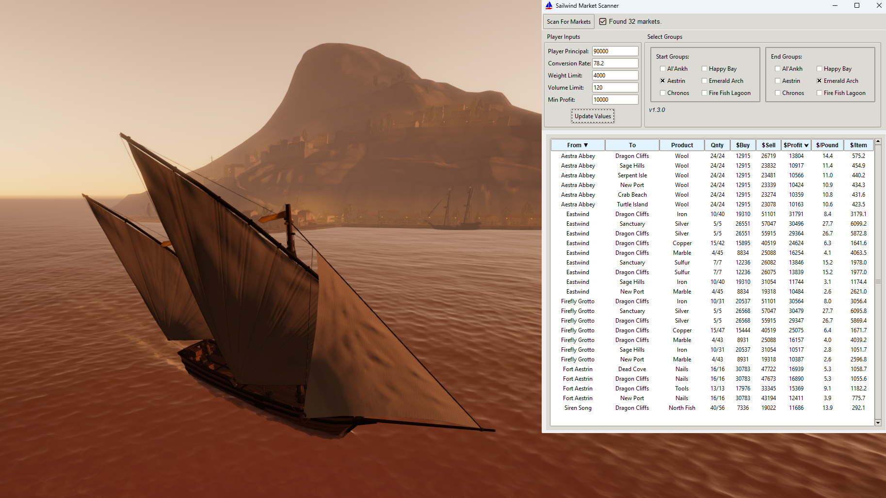

# ⛵ Sailwind Market Watcher for 0.33.2


A real-time market and trade route analyzer for the open-world sailing game **Sailwind**.

This tool connects to your running game, reads market data directly from memory, and helps you plan the most profitable trade routes between ports — all via an interactive graphical interface.

---

🚀 **How to Use**

1. Launch Sailwind
2. Once in-game, run `main.py` using Python
3. Click "Scan For Markets" in the GUI
4. Enter your player values:
   - Currency exchange rate
   - Cargo limits (mass/volume)
   - Available money
   - Minimum profit
5. Select your start and destination island groups
6. Browse the trade table for top opportunities!

---

## 📌 Features

✅ **Live Memory Scan**\
Scans all 32 in-game markets for live product supply data and prices.

💰 **Profit-Driven Trade Routes**\
Automatically finds the most profitable trades based on:

- Total profit
- Profit per pound (weight)
- Profit per item

🎯 **Player-Conscious Filtering**\
Takes into account your current:

- Money
- Cargo mass & volume limits
- Minimum profit threshold

🌎 **Regional Trade Planning**\
Select specific **start** and **destination** island groups to tailor your strategy.

🖼️ **Interactive GUI**\
A modern, user-friendly interface with:

- Sortable Columns for simple analytics
- Live-updating trade table
- Tooltips for helpful guidance
- Input fields for cargo & currency

---

💡 **Development** This project is written in Python using:

- `tkinter` for the GUI
- `pymem` for memory access
- `Pillow` for image icons

---

🧠 **How It Works**

- Uses `pymem` to attach to the running `Sailwind.exe` process
- Scans for a known byte pattern to locate in-game market objects
- Reads each market’s name, product list, and supply value directly from memory
- Applies the game’s pricing formula to calculate sell/buy values dynamically:

```python
def calc_sell_price(supply, V):
    coeff = 0.38 if supply > 0.5 else -1.68
    return ceil((coeff * V / 10000) * (supply ** 2) - (abs(coeff) * V / 50) * supply + V)
```

- Builds a table of trade routes, ranked by total and per-item profit

---

💱 **Currency Conversion** The game uses different currencies in different regions (Lions, Dragons, Crowns, etc). To calculate trades properly:

1. Visit a Currency Exchange port in the game
2. Use the posted exchange rate to convert to Lions
3. Enter that value into the app’s Conversion Rate field

💡 Estimated values shown in the app:

```
Lions ≈ 34.0
Dragons ≈ 330
Crowns ≈ 82.0
```

Use the actual in-game rate when possible for best results.

---

## 🧰 Requirements

- Windows OS
- Python 3.9+
- The game [**Sailwind**](https://store.steampowered.com/app/1284190/Sailwind)[ on Steam](https://store.steampowered.com/app/1284190/Sailwind) Version 0.32
- Python dependencies:
  - `pymem`
  - `pillow`
## 🐍 Installation Guide (Windows)

Follow these steps to install Python, set up dependencies, and run **Sailwind Market Watcher**.

---

### ✅ 1. Install Python

1. Download Python from the official site:\
   👉 [https://www.python.org/downloads/windows](https://www.python.org/downloads/windows)

2. Run the installer and:

   - ✅ **Check** “Add Python to PATH”
   - Click **Install Now**
   - Wait for it to finish, then click **Close**

---

### 🖥️ 2. Open Command Prompt

To open a Command Prompt window:

- Press **Windows key**, type **cmd**, and press **Enter**

Or to open it in the app folder:

- Hold **Shift** and **Right-click** in the folder window
- Choose **"Open PowerShell window here"** or **"Open Command Window Here"**

---

### 📁 3. Download the Project

**Option A: Download ZIP**

- Go to [Sailwind Market Watcher GitHub](https://github.com/Weirwindle/sailwind-market-watcher)
- Click the green **“Code”** button → **“Download ZIP”**
- Extract the folder

**Option B: Use Git (optional)**

```bash
git clone https://github.com/Weirwindle/sailwind-market-watcher.git
```

---

### 📦 4. Install Required Dependencies

Navigate to the extracted folder in Command Prompt:

```bash
cd path\to\Sailwind-Market-Watcher
```

Then install the required Python packages:

```bash
pip install -r requirements.txt
```

---

### 🚀 5. Run the App

While in the folder, run:

```bash
python main.py
```

Make sure Sailwind is running before launching the app.


---

## 🐞 Troubleshooting

- **"Could not read memory"**: Make sure Sailwind is running
- **"Markets not found"**: Game update changed memory layout — wait for fix
- **App closes instantly**: Run from terminal to see errors: `python main.py`
- **tkinter not found**: Linux users may need: `sudo apt install python3-tk`

---

## 🔄 Changelog

## [v1.3.0] - 2025-10-13
### Added
- Sortable Columns. 
    Primary Sort on Origin and Destination Columns
    Secondary Sort on $Profit, $/Pound, and $/Item metrics
- Clean up and refactoring

## [v1.2.0] - 2025-10-12
### Added
- Support the 3 new Al Ankh islands. Old Ankh Town, Mirage Island and Saffron Island
- 2 New tradable items. Salt and Saffron

## [v1.1.0] - 2025-07-02
### Added
- Support for 2 new islands in latest Sailwind version
- 3 new tradeable items

### Fixed
- Fixed Emeralch Arch trades not showing because of a misname
- Removed Unneeded Library PSutil

## [v1.0.0] - 2025-06-29
### Added
- Initial release of Sailwind Market Watcher
- Trade route table and player settings input


---

## 📜 License

MIT License. See [LICENSE](LICENSE) file.
